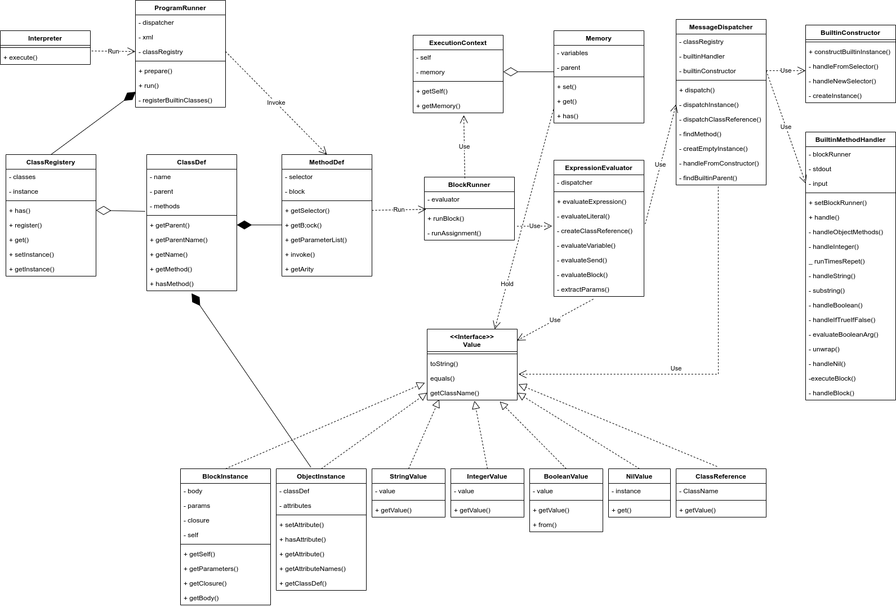

Documentation of Project Implementation for IPP 2024/2025
Name and surname: Daria Kinash
Login: xkinas00

## 1. Introduction

This interpreter executes programs written in the object-oriented language **SOL25**, defined in XML format. The language supports **user-defined classes**, **inheritance**, **attributes**, and **dynamic message passing** between objects.

The project is structured to simulate object communication by interpreting selectors (messages) sent to runtime values. The system handles both built-in types (like Integers and Strings) and user-defined objects. Execution is based on dynamic dispatch, closures, and recursive evaluation of expression trees from the XML.

## 2. Internal Representation

### Classes and Methods

Each class is represented by a `ClassDef` object. It contains the class name, an optional parent class name, and a collection of methods. Methods are stored as `MethodDef` instances, which contain the selector and a reference to the DOM `<block>` element defining the method body.

All classes are stored in a global `ClassRegistry`, which allows fast lookup by name and helps resolve inheritance during message dispatch.

### Objects and Values

All values in the interpreter implement the `Value` interface. 

- **Primitive values** are represented as `IntegerValue`, `StringValue`, `BooleanValue`, or `NilValue`.
- **User-defined object instances** are represented as `ObjectInstance`, which contains a pointer to its `ClassDef` and a set of named attributes.
- **Code blocks** are represented by `BlockInstance`, which store the method body, parameters, closure memory, and the `self` object.
- **Class references** are represented by `ClassReference`, which allows messages like `String new` or `Integer from:` to be handled properly.

## 3. Execution and Evaluation

The program begins execution in the `Interpreter` class, which creates a `ProgramRunner`. This component:

- Parses the XML input into a DOM structure,
- Registers each class into the `ClassRegistry`,
- Locates the `Main` class and runs the `run` method.

For executing blocks of code, the interpreter uses the `BlockRunner`. This class works with the `ExecutionContext`, which stores the current instance (`self`) and a `Memory` object for local variables. 

A `BlockRunner` walks through the method block, and uses `ExpressionEvaluator` to evaluate individual expressions. It handles literals, variable lookups, blocks, and message sends. The most complex case is `<send>`, where the evaluator must:

- Determine the receiver,
- Evaluate the argument list,
- Forward the message to `MessageDispatcher`.

## 4. Message Dispatch and Built-in Behavior

The `MessageDispatcher` resolves method calls dynamically. If the receiver is a user-defined `ObjectInstance`, it checks whether the selector exists in the associated `ClassDef`. If found, it invokes the method with a new memory context.

If the selector is not found, and the receiver is a built-in value, the message is passed to the `BuiltinMethodHandler`. This handler implements logic for selectors like `plus:`, `asString`, `print`, `ifTrue:ifFalse:`, etc.

Class-level messages like `Integer new` or `String from:` are handled using the `ClassReference` mechanism. In such cases, the dispatcher identifies the referenced class, checks for a matching constructor method, or forwards the message to the `BuiltinConstructor`.

## 5. Special Handling and Problem Solving

One of the main issues encountered during implementation was the handling of **class-level method calls** like:

```xml
<send selector="from:">
    <expr>
        <literal class="class" value="Integer"/>
    </expr>
    <arg order="1">
        <expr>
            <literal class="Integer" value="5"/>
        </expr>
    </arg>
</send>
```

To solve this, a type `ClassReference` was introduced to represent a reference to a class in the runtime. This allowed proper dispatch of `new` and `from:` messages on built-in and user-defined classes.

Another challenge was how to **simulate value wrapping** for primitive types when used with user-defined `from:` methods. If an `Integer` or `String` is passed to a `from:` method, and the target class is not a built-in, we create an `ObjectInstance` and store the primitive value inside as a `value` attribute. This ensures that `MyClass from: 5` creates a valid instance with correct data, even if `MyClass` is not a built-in type.

## 6. Exception Handling

Error handling follows the interpreter specification and uses custom exception classes. These include:

- `UndefinedException` – for undefined variables or classes
- `DoesNotUnderstandException` – for unknown messages
- `TypeErrorException` – for invalid argument or receiver types
- `ValueErrorException` – for domain errors (e.g. division by zero)
- `InternalErrorException` – for unexpected interpreter logic failures

## UML Diagram

The following diagram shows the core classes, their relationships, and runtime structure used by the interpreter:


